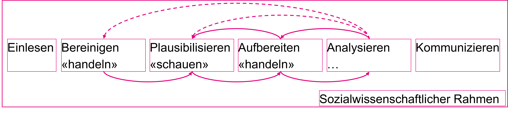

# Einführung in den Kurs {.unnumbered}

Das Seminar bietet eine systematische Einführung in R und RStudio. R ist eine Open Source Software, die sich unter anderem durch Flexibilität sowie durch vielfältige Möglichkeiten der numerischen und grafischen Datenanalyse auszeichnet. Das Seminar vermittelt einerseits den Aufbau des Programms und dessen Funktionsweisen allgemein. Andererseits werden gewisse statistische Verfahren in inhaltlicher Abstimmung mit der Vorlesung „Einführung in die Statistik“ behandelt. Es werden Techniken des effizienten Datenmanagements, das Programmieren einfacher Funktionen sowie Formen der grafischen Datenanalyse und Ergebnisdarstellung besprochen. Dabei versuchen wir die Realität des statistischen Arbeitens zu vermitteln.


::: callout-important
Für administrative Belange (insb. **Leistungsnachweis**) lesen Sie bitte den **Syllabus** (verfügbar auf [OLAT](https://lms.uzh.ch/url/RepositoryEntry/17753735758/CourseNode/79952613784216) sorgfältig.
:::

Wir orientieren uns an einer Vorstellung der sozialwissenschaftlichen Datenanalyse, die folgende Teile enthält [@WickhamGrolemund2016]:

```{r echo=FALSE, fig.cap="Modell Datenanalyse"}

```

Als Erstes müssen die Daten **eingelesen**, beziehungsweise importiert werden. Diese gilt es dann **zu prüfen** und **aufzubereiten**. Das bedeutet, dass Sie die Daten in eine konsistente Form bringen (z.B. sollte jede Zeile einer Person und jede Spalte einer Variablen entsprechen).

In einem zweiten Schritt müssen die Daten **gefiltert und selektiert** werden. Das heisst, die Fälle und ihre Ausprägungen werden zur Forschungsfrage passend ausgewählt (z.B. auf alle Personen, die über ein bestimmtes Einkommen verfügen, und es interessieren die Variablen "Einkommen" und "Bildungsniveau"). Zudem müssen oftmals **neue Variablen** erstellt werden, die sich aus bestehenden Variablen herleiten lassen (z.B. die Ausprägungen der Variable "Einkommen" zu Einkommensklassen zusammenfassen). Diese vorbereitenden Arbeiten sind ein grosser Teil der statistischen Analyse [@WickhamGrolemund2016]. Das Ziel dieser Vorbereitungen ist, die Daten in eine Form zu bringen, mit der Sie die vorgesehene(n) Analyse(n) durchführen können. Danach ist es möglich, verschiedene **zusammenfassende Statistiken** zu berechnen (z.B. verschiedene univariate Kennwerte).

Wenn die Daten in einer (vorerst) optimalen Form vorliegen, gibt es zwei Arten der Wissensgenerierung [@WickhamGrolemund2016, x]: Visualisierung und Modellierung. Mittels **Visualisierung** lässt sich schnell eine Übersicht gewinnen (z.B. ob zwischen zwei Variablen ein Zusammenhang bestehen könnte). **Modellierungen** wiederum ergänzen diese ersten Einsichten, indem sie Zusammenhänge quantifizieren (z.B. wie stark ist dieser Zusammenhang?).

Aufbereitung, Visualisierung und Modellierung der Daten erfolgen nicht linear nacheinander, sondern es bestehen immer wieder Wechselwirkungen und Rückbezüge. Der letzte Schritt der Datenanalyse ist die **Kommunikation**. Kommuniziert werden neben den Ergebnissen der Analyse auch das Vorgehen.

Diese Prozesse der Datenanalyse finden alle in einem bestimmen **Rahmen** statt [vgl. auch @Sauer2019, 3]: Einerseits die Idee des Programmierens [vgl. @WickhamGrolemund2016, xi], und andererseits die Sozialwissenschaften, die einen Rahmen für die Datenstrukturen (z.B., dass eine Person ein Fall und damit eine Zeile ist), angemessene Ziele der Analyse oder Interpretationen der Resultate (z.B. ab welcher Grösse des Zusammenhangsmasses ist der Zusammenhang "stark"?) bilden.

## Ziel des Kurses

Das Seminar verfolgt zwei miteinander verbundene übergeordnete Lernziele. (1) Sie eignen sich Grundkenntnisse der statistischen Datenanalyse mit R an. (2) Sie wenden ausgewählte Verfahren der Vorlesung «Einführung in die Statistik» praktisch an.[^e01-1]

[^e01-1]: Das Seminar funktioniert nicht als Übung zur Vorlesung. Nicht alle Inhalte der Vorlesung werden im Seminar behandelt.

Konkret können Sie

- Funktionsweise und Struktur von R und RStudio erläutern.
- Datenformate R Skript und R Markdown (angemessen) verwenden.
- Grundlegende Funktionen (siehe Seminarplan) in R anwenden.
- Abläufe softwaregestützter Datenanalyse erklären. 
- Grafische Verfahren für die Datenanalyse anwenden und interpretieren.
- Ausgewählte multivariate Verfahren in RStudio anwenden und die Resultate inter-pretieren.
- Übliche Herausforderungen beim Arbeiten mit Daten eigenständig bewältigen.