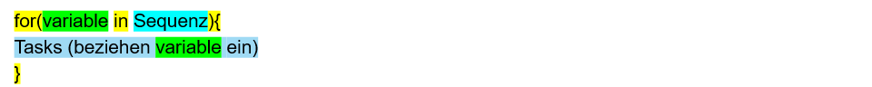

# Woche 8 {.unnumbered}

*"Loops"/for-Schleifen*

## Lernziele

In den letzten Wochen haben wir verschiedene Funktionen kennengelernt, um Daten zu bereinigen, zu plausibilisieren und aufzubereiten. Zudem haben wir insbesondere die Funktionen zur Erstellung von Grafiken angewendet, um erste interessante Ergebnisse zu generieren. In dieser Woche schauen wir uns an, in welchen Fällen for-Schleifen.

Konkret:

-   Sie erläutern, wozu und in welchen Fällen for-Schleifen nützlich sind.
-   Sie erklären, wie eine for-Schleife funktioniert.
-   Sie erstellen einfache for-Schleifen.

## Aufgaben

::: callout-important
## for-Schleifen

Operationen, die mehrfach ausgeführt werden sollen, können mit for-Schleifen oder Funktionen erfasst werden.

[**Good Practice:**]{style="color:darkgreen;"}

-   for-Schleifen nur verwenden, wenn keine Alternativen möglich sind, denn sie sind vergleichsweise langsam. Wenn immer möglich ist Vektorisierung oder `apply()` vorzuziehen.
-   Wenn Sie for-Schleifen verwenden, packen Sie so wenige "Tasks" wie möglich in die Schleife. Denn "Tasks" in der Schleife werden bei jedem Durchgang ausgeführt!
:::

### Aufgabe 1: summary-Output mit for-Schleif nachbauen

Bauen Sie den summary-Output der numerischen Variablen mit einer for-Schleife nach. Orientieren Sie sich am untenstehenden Aufbau einer For-Schleife.

```{r echo = FALSE, fig.cap = "Aufbau einer For-Schleife. Gelb markierte Elemente sind fix, die anderen sind zu definieren."}

```

Hinweis: Bilden Sie einen Vektor mit den numerischen Variablen, die bearbeitet werden sollen und verwenden Sie diesen Vektor für den for-Loop (in der Initiierung, d.h. in den runden Klammern, und auch im Rumpf, d.h. in den geschweiften Klammern).

`v.num <- c("agea", "yrbrn", "eduyrs", "wkhtot")`

Beispiel, wie dieser Vektor im Loop-Rumpf verwendet wird:
`min(d.ch.k[, v.num[i]])`

Alle Outputs fügen Sie mit z.B. `rbind()` und/oder `paste()` zusammen und speichern das als Objekt im Rumpf. 
Objekte, die in einem Loop generiert werden, werden standardmässig nicht rausgeschrieben, sondern «verschwinden» nach Abbruch des Loops. Deshalb braucht es als letzte Funktion im Rumpf noch `print(hier der Name Ihres Objekts)`.

### Aufgabe 2: Code lesen

Beschreiben Sie, was untenstehender Code macht und inwiefern diese for-Schleife sinnvoller ist als jene, die Sie in Aufgabe 1 gebaut haben. (Kommentieren Sie den Code aus.) Hinweis: `kmeans(mca1$ind$coord[, c("Dim 1", "Dim 2")], i)$withinss` ruft die Within-Clustervarianz von i Clustern auf, die mit der Funktion `kmeans()` von Koordinaten (`mca1$ind$coord[, c("Dim 1", "Dim 2")]`) gebildet wurden.

```{r, eval = F}
wss <- rep(0, 18)
for(i in 1:17){
  wss[i] <- sum(kmeans(mca1$ind$coord[, c("Dim 1", "Dim 2")], i)$withinss)
}
plot(1:18, wss, type = "b", xlab = "", ylab = "")
```

### Aufgabe 3: eigenes Beispiel

Entwickeln Sie einen eigenen Loop, der für die Plausibilisierung und Aufbereitung hilfreich ist.

*Reflexion (bitte betiteln Sie diesen Abschnitt auch mit "Reflexion" in
Ihrem Markdown-Dokument!)*

Bitte reflektieren Sie und halten stichpunktartig fest:

-   Was ist Ihnen klar geworden?
-   Wo sind Sie noch unsicher? Was hat noch nicht geklappt?

## Lösungen

```{r}
source(file = "C:/Users/BisangL/Documents/c_fuer_quarto/skripts/datenaufbereitung_ess11.R")
```

### Aufgabe 1: summary-Output mit for-Schleife nachbauen

```{r}
summary(d.ch.k) # min, 1., 2. Quartil, mean,  3. Quartil, max
v.num <- c("agea", "yrbrn", "eduyrs", "wkhtot") # Variablen, die bearbeitet werden sollen 
# die Gewichtungsvariablen wurden für W7, Aufg. 5 aufgenommen und werden hier nicht berücksichtigt
```

Die Funktion gibt für jede Variable eine Zusammenfassung aus. Sie berechnet für jede metrische Variable den Mittelwert, sowie die Lage- und Streuungsmasse. Wir starten mit den "Tasks" und bauen Schritt für Schritt eine Schleife auf:

```{r}
mean(d.ch.k$agea, na.rm = T) # das müssen wir mit dem indizierten Vektor v.num schreiben
i <- 1 # dazu setzen wir erstmal i auf 1
mean(d.ch.k[, v.num[i]], na.rm = T) # funktioniert
# wir versuchen es noch für einen zweiten Output
max(d.ch.k[, v.num[i]], na.rm = T) # funktioniert
# und verbinden die Outputs zu einer Tabelle...
rbind(paste("mean", mean(d.ch.k[, v.num[i]], na.rm = T)),
      paste("max", max(d.ch.k[, v.num[i]], na.rm = T))) # funktioniert
# dasselbe dann für die anderen Outputs...
# min, 1., 2. Quartil, mean,  3. Quartil, max

for (i in 1:length(v.num)) {
  t.sum <- rbind(
    paste("Variable", v.num[i]),
    paste("min", min(d.ch.k[, v.num[i]], na.rm = T)),
    paste("1. Quartil", quantile(d.ch.k[, v.num[i]], probs = 0.25, na.rm = T)),
    paste("Median", quantile(d.ch.k[, v.num[i]], probs = 0.5, na.rm = T)),
    paste("mean", round(mean(d.ch.k[, v.num[i]], na.rm = T), 2)),
    paste("3. Quartil", quantile(d.ch.k[, v.num[i]], probs = 0.75, na.rm = T)),
    paste("max", max(d.ch.k[, v.num[i]], na.rm = T))
    )
  print(t.sum)
}
```

### Aufgabe 2: Code lesen

Die Schleife rechnet für das i-te Cluster die Summe der Within-Clustervarianz. i ist die Variable, die bei jeder Iteration um 1 erhöht wird (Sequenz: 1:17). Die Summen werden danach in einem Plot dargestellt. Dieser Loop ist sinnvoller als die nachgebaute summary-Funktion, weil wir immer die einfachste Lösung bevorzugen. Um eine Zusammenfassung der Daten zu erhalten, ist entsprechend die `summary()`-Funktion einer selbstgebauten for-Schleife vorzuziehen.

### Aufgabe 3: eigenes Beispiel

(individuell)