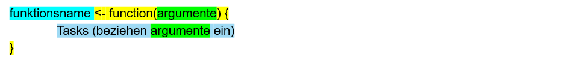

# Woche 9 {.unnumbered}

*Funktionen und if-else-Statements*

## Lernziele

In den letzten Wochen haben wir verschiedene Funktionen kennengelernt, um Daten zu bereinigen, zu plausibilisieren und aufzubereiten. Zudem haben wir insbesondere die Funktionen zur Erstellung von Grafiken angewendet, um erste interessante Ergebnisse zu generieren. In dieser Woche schauen wir uns an, wie Sie Funktionen selbst schreiben, und in welchen Fällen diese sinnvoll sind.

Konkret:

-   Sie erläutern, wozu und in welchen Fällen Funktionen nützlich sind.
-   Sie erläutern, wie Funktionen in R aufgebaut sind.
-   Sie schreiben eine Funktion.
-   Sie erklären, wie if-else-Statements funktionieren und wenden die Funktion `ifelse()` an.

## Aufgaben

### Aufgabe 1: Funktionsaufbau

Schauen Sie sich die Hilfeseite der `ifelse()`-Funktion an. Erklären Sie in wenigen Sätzen den Aufbau.

### Aufgabe 2: Anwendung

Bilden Sie eine Funktion, die im Funktionskörper die `ifelse()`-Funktion enthält. Orientieren Sie sich am unten aufgeführten Aufbau einer Funktion (und ggf. an den Beispielen auf OLAT, Sitzung 8). Begründen Sie den/die Task/s, welche die Funktion ausführt (gerne dürfen Sie hier mit einem LLM arbeiten und dessen Output mit Ihren Kenntnissen verbessern!). Wenden Sie die Funktion auf eine Variable des gekürzten Datensatzes an und speichern Sie das Resultat in einer neuen Variable. Diskutieren Sie, inwiefern dieses Vorgehen sinnvoll ist.

```{r echo = FALSE, fig.cap = "Aufbau einer Funktion. Gelb markierte Elemente sind fix, die anderen sind zu definieren."}

```

### Aufgabe 3: eigenes Beispiel

Entwickeln Sie eine eigene Funktion, die im Rahmen der Plausibilisierung und Aufbereitung hilfreich ist.

*Reflexion (bitte betiteln Sie diesen Abschnitt auch mit "Reflexion" in
Ihrem Markdown-Dokument!)*

Bitte reflektieren Sie und halten stichpunktartig fest:

-   Was ist Ihnen klar geworden?
-   Wo sind Sie noch unsicher? Was hat noch nicht geklappt?