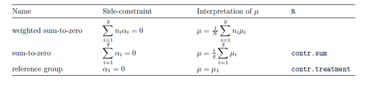

# Woche 11 {.unnumbered}

*Repetition einfache lineare Regression*

## Lernziele

Im Rahmen dieser Aufgaben werden keine neuen Themen eingeführt, sondern Aspekte (Zugriff auf lm-Objekt und Interpretation des Modells) der Woche 10 wiederholt.

Konkret:

-   Sie erklären die Struktur eines lm-Objekts.
-   Sie interpretieren das Modell und schätzen dessen Güte ein.

## Aufgaben

1.  Arbeiten Sie mit dem Modell mit der metrischen unabhängigen Variable von letzter Woche. Greifen Sie auf Elemente des lm-Objekts zu.

    a.  Erstellen Sie einen Plot mit der Vorhersagewerte für y auf der x-Achse und den Residuen des Modells auf der y-Achse (Tukey-Anscombe-Plot). Wie ist dieser Plot zu interpretieren?

    b.  Plotten Sie die unabhängige Variable gegen die abhängige Variable (nutzen Sie dazu auch die Elemente des lm-Objekts). Ergänzen Sie dann bei dieser zweiten Darstellung die Regressionsgerade mittels `abline()`.

2.  R integriert kategoriale Variablen im Regressionsmodell als Dummy-Variablen (0-1 kodierte Variablen). Fügen Sie dem Datensatz die benötigten Dummy-Variablen für eine Variable an. Wie viele Dummy-Variablen benötigen Sie?

3.  Interpretieren Sie einen der p-Werte in Ihrem Modell (lesen Sie ggf. in Diaz-Bone 2023 nach) und halten Sie die Interpretation schriftlich fest.

4.  Repetition: Notieren Sie, welche Datenarten mit welchen bivariaten Plots dargestellt werden können (konsultieren Sie die Lösungen und Inputs von Woche 8). Prüfen Sie die Plots aus Woche 10 dahingehend und auf Ihre Aussagekraft. Begründen Sie jeweils Ihre Wahl und korrigieren Sie sie, falls nötig. Reichen Sie die Plots von Woche 10 nochmals ein.

*Reflexion (bitte betiteln Sie diesen Abschnitt auch mit "Reflexion" in Ihrem Markdown-Dokument!)*

Bitte reflektieren Sie und halten stichpunktartig fest:

-   Was ist Ihnen klar geworden?
-   Wo sind Sie noch unsicher? Was hat noch nicht geklappt?

## Lösungen

```{r}
source(file = "C:/Users/BisangL/Documents/c_fuer_quarto/skripts/datenaufbereitung_ess11.R")
```

```{r}
#Modelle wiederherstellen
lm.met <- lm(eduyrs ~ agea, data = d.ch.k)
lm.bin <- lm(wkhtot ~ gndr, data = d.ch.k)
lm.ord <- lm(wkhtot ~ edlvdch_zf, data = d.ch.k)
```

1.  Zugriff auf das lm-Objekt

    a.  Tukey-Anscombe-Plot mit Interpretation

```{r}
plot(lm.met$fitted.values, lm.met$residuals, xlab = "Fitted Values", 
     ylab = "Residuals", main = "Tukey-Anscombe-Plot")
abline(h = 0, col = "blue") # Residuen sollen um 0 streuen
```

Die Grafik dient der Überprüfung zweier Anwendungsvoraussetzungen der linearen Regression: Wir sehen, ob die Residuen um Null streuen und ob sie gleich bleibende Varianz (Homoskedastizität, "paralleles Band") aufweisen.

```         
b.  Unabhängige gegen abhängige Variable
```

Im Unterobjekt "coefficients" finden wir die beiden benötigten Werte:

```{r}
str(lm.met$coefficients)
lm.met$coefficients
```

Es sind zwei Werte (Intercept und Koeffizient für agea) enthalten. Wir können sie durch Indizieren auswählen:

```{r}
plot(x = lm.met$model$agea, y = lm.met$model$eduyrs,
     xlab = "Alter", ylab = "Vertrauen in Mitmenschen",
     main = "Metrisches Regressionsmodell")
abline(a = lm.met$coefficients[1], b= lm.met$coefficients[2],
       col = "red")
```

Interpretation der beiden Werte:

Der *Intercept* (\$\\beta_0\$, y-Achsenabschnitt) gibt den Vorhersagewert an, wenn die unabhängige Variable 0 ist, also wenn jemand 0 Jahre alt wäre.

Der *Koeffizient* $\beta_1$ gibt die Zunahme des Vorhersagewertes an, wenn wir $x_1$ um eine Einheit erhöhen. Da der Koeffizient leicht negativ ist, nehmen die Bildungsjahre mit zunehmendem Alter leicht ab -- das macht keinen Sinn. Ein Modell mit Altersklassen wäre hier wohl sinnvoller (z.B. Personen zusammenfassen, die noch in Ausbildung sein könnten, jene, die meist nur neun Jahre Schulbildung absolviert haben, oder der Rest...).

```{r}
summary(lm.met)
```

R-Quadrat [*Multiple R-squared* sowie dessen leichte Anpassung, die den Wert in der Grundgesamtheit schätzt, @Diaz-Bone2023, 223] kann zwischen 0 und 1 variieren. Dieses Modell (hier nur Alter) erklärt nur ein sehr kleiner Anteil der Varianz der Bildungsjahre.

::: callout-important
## Unterschiedliche R-Quadrat-Werte visualisiert

Im Plot oben links hat X keinen Einfluss auf Y (b1 = 0). Die anderen drei Plots zeigen Modelle mit demselben b1-Wert, aber unterschiedlichen R-Quadrat-Werten. Unten links ist der perfekte Fit dargestellt [@Diaz-Bone2023, 107].

```{r echo = FALSE, fig.cap = "4 Regressionsmodelle"}
knitr::include_graphics("Bilder/Modelle.jpg")
```
:::

2.  Faktoren im Regressionsmodell

Die anderen beiden Modelle enthalten keine metrische X-Variable, sondern binomiale und ordinale Variablen. Dies ist in der Interpretation zu berücksichtigen:

```{r}
summary(lm.bin)
```

Wir sehen, dass gndr*w* im Output steht. Das heisst, R hat standardmässig die Kategorie *m* als Referenzkategorie gewählt (da der numerische Code tiefer ist). Der Koeffizient gibt die Änderung der Zielgrösse an, wenn man von "männlich" zu "weiblich" wechselt, und alle anderen Koeffizienten konstant hält (siehe auch Lösung Woche 10).

Dasselbe Prinzip -- die Veränderung beim Wechsel von Referenzkategorie zu einer anderen Kategorie -- gilt auch für kategoriale Variablen mit mehr als zwei Ausprägungen, wenn wir die Contrasts entsprechend definieren. Hierbei werden im Hintergrund für k-1 Ausprägungen Dummy-Variablen erstellt, womit R erst die lineare Regression rechnen kann (dazu braucht es zudem die eine Zusatzbedingung ("contrasts"), die angibt, wie gerechnet werden soll, siehe nachfolgend).

Das Prinzip der Dummy-Variable können wir wie folgt veranschaulichen:

```{r}
unique(d.ch.k$edlvdch_zf)
```

Die Variable hat insgesamt vier Levels, deshalb benötigen wir drei Dummy-Variablen, um die Variable vollständig zu beschreiben. Wir können sie folgendermassen bilden:

```{r}
# von Hand
d.ch.k$edlvdch_prim <- ifelse(d.ch.k$edlvdch_zf == "prim", 1, 0)
d.ch.k$edlvdch_sek1 <- ifelse(d.ch.k$edlvdch_zf == "sek1", 1, 0)
d.ch.k$edlvdch_sek2 <- ifelse(d.ch.k$edlvdch_zf == "sek2", 1, 0)

table(d.ch.k$edlvdch_prim, useNA = "always")
table(d.ch.k$edlvdch_sek1, useNA = "always")
table(d.ch.k$edlvdch_sek2, useNA = "always")

# oder mit Funktion...
# install.packages("psych")
library(psych)
dummies <- dummy.code(d.ch.k$edlvdch_zf) # hier werden alle Ausprägungen kodiert...
# d.ess <- cbind(d.ess, dummies) # auskommentiert, da sonst doppelt im DF
```

Nun können wir das Prinzip der Dummy-Variablen nachvollziehen: Wenn jemand bei allen drei Variablen 0 hat, entspricht es dem Level tert. Wenn die Person bei edlvdch_prim eine 1 hat (und folglich bei allen anderen 0), dann wäre es das Bildungsniveau "Primar", usw.

::: callout-important
## Contrasts -- "Kodierungssyssteme"/Nebenbedingungen

Damit R kategoriale Variablen in lineare Regressionsmodelle aufnehmen kann, müssen sie umkodiert werden. Dabei sind unterschiedliche Berechnungsweisen für die Koeffizienten der Levels möglich. Die Berechnungsweise muss angegeben werden, damit R die Koeffizienten eindeutig bestimmen kann.

Bei nominalen Variablen wird standardmässig eine einfacher zu interpretierende Kodierungs- und Berechnungsvariante ("contr.treatment") verwendet. Dabei werden k-1 Levels dummy-kodiert. Die Designmatrix, auf der die Berechnung basiert, sieht folgendermassen aus:

```{r}
contr.treatment(levels(d.ch.k$edlvdch_zf))
```

Das nicht-kodierte Level (d.h. alle kodierten Level den Wert Null) ist das Referenzlevel. Dieses wird zur Berechnung auf Null gesetzt. Die berechneten Koeffizienten vergleichen den Mittelwert der abhängigen Variable für das Referenzlevel mit dem x-ten Level. Das heisst, wenn man vom Referenzlevel zum x-ten Level wechselt, verändert sich die abhängige Variable im Schnitt um den Koeffizienten.

Standardmässig wendet R für ordinale Faktoren "contr.poly" an, das heisst, R verwendet "orthogonale Polynome". Diese Berechnungsweise würde es erlauben, lineare (.L), quadratische (.Q) und höher geordnete (cubic, .C) Trends aufzunehmen. Die berechneten Koeffizienten sind allerdings schwer interpretierbar, zum einen, weil die Koeffizienten von der R-internen Parametrisierung abhängt, und zum anderen, weil die Abstände der Faktor-Levels "äquidistant" sein, d.h. (sinnvoll) gleichweit auseinander liegen müssen (was hier nicht der Fall ist). Die p-Werte sind insofern interpretierbar, als sie angeben, welcher Teil (z.B. linear) signifikant ist (Nullhypothese für .L: Die lineare Komponente der x-y-Beziehung ist 0).

Eine weitere Variante ist "contr.sum", wobei zur Berechnung der Koeffizienten die Summe in der Designmatrix auf Null gesetzt wird. Im Output ist dann die Differenz zwischen dem durchschnittlichem x und dem durchschnittlichem Intercept (Referenzlevel) ersichtlich.

```{r}
contr.sum(levels(d.ch.k$edlvdch_zf))
```

Die Kodierung (und Berechnung) variiert nach Fragestellung. Allerdings beschränken wir uns hier auf "contr.treatment", weil dies besonders leicht zu interpretieren ist.

{fig-align="left"}
:::

```{r}
options(contrasts = c("contr.treatment", "contr.treatment"))
lm.ord.2 <- lm(wkhtot ~ edlvdch_zf, data = d.ch.k)
summary(lm.ord.2)
```

Dadurch sind die Koeffizienten inhaltlich interpretierbar. Konkret führt der Wechsel vom ersten (Referenzkategorie, Primar) auf das vierte Bildungsniveau (Tertiär) dazu, dass die Wochenarbeitsstunden abnehmen.

3.  Inferenzstatistische Interpretation der Modelle

```{r}
summary(lm.met)
```

Wenn wir zur inferenzstatistischen Interpretation übergehen, dann fragen wir uns, ob die Daten mit einem Modell mit diesen Parametern verträglich ist ([@Stahel2008]), resp. ob unser Modell insgesamt und die Effekte der unabhängigen Variablen von der Stichprobe auf die Grundgesamtheit übertragen werden können. Dies wollen wir *testen* [vgl. @Diaz-Bone2023, 215ff].

Führen wir das Test-Prozedere von Hand durch, gehen wir in vier Schritten vor (in der Praxis übernimmt das R für uns, aber wir müssen wissen, was R tut!). Diese Schritte helfen uns auch, die Werte im R-Output zu verstehen.

(1) Problem: Haben das Modell insgesamt und die Effekte der unabhängigen Variablen einen Einfluss in der Grundgesamtheit?

(2) Hypothesen

H0:\
Alle x-Variablen haben in der GG keinen Einfluss auf die Zielgrösse (hier: \$\$\\beta_1 = 0\$\$).\
bzw.\
Die Variable Alter hat keinen Einfluss auf das Vertrauen in der GG (\$\$\\beta_1 = 0\$\$).

H1:\
Mindestens eine x-Variablen hat in der GG einen Einfluss auf die Zielgrösse (hier: \$\$\\beta_1 != 0\$\$).\
bzw.\
Die Variable Alter hat einen Einfluss auf das Vertrauen in der GG (\$\$\\beta_1 != 0\$\$).

(3) Teststatistik:

    für t-Test...

    für F-Test...

(4) Konstruktion der Stichprobenverteilungen

    Unter Annahme der Nullhypothese konstruieren wir die theoretischen Verteilungen der Stichprobenwerte (Vorstellung: wir würden unendlich viele Stichproben ziehen, t-Verteilung resp. F-Verteilung).

Um zu testen, ob alle Koeffizienten (hier nur $\beta_1$) im Modell Null sind, erstellen wir eine F-Verteilung mit Freiheitsgrade df1 = 1 (Anzahl Prädiktoren) und df2 = "Anzahl gültige Fälle abzüglich Anzahl Koeffizienten" (1384 - 117 - 4), siehe auch *1263 DF* im Summary).

```{r}
v1 <- seq(0, 5, length.out = 1000) 
fv <- df(v1, 1, 1263) # Dichte dieser Verteilung
```

Für die $\beta_1$-Werte berechnen wir eine T-Verteilung, die durch (n - 2) Freiheitsgrade (1384 - 117 - 2) bestimmt ist:

```{r}
v2 <- seq(-4, 4, length.out = 1000) # b^1 negativ/positiv
tv <- dt(v2, 1265) # Dichte dieser Verteilung
```

Da wir nur ein x im Modell haben, prüfen F- und t-Test dasselbe und sind entsprechend gleich.

(3) Annahme- und Rückweisungswert

Diese Verteilungen können wir darstellen und jeweils den Annahme- und Rückweisungswert einrichten (siehe untenstehende Grafik, rot schraffiert). Der Rückweisungsbereich umfasst Werte, die so extrem sind, dass sie zur Verwerfung der Nullhypothese führen. Dies erfolgt auf einem bestimmten Signifikanzniveau ( \$\\alpha = 5\\%\$ ).

(4) Auswertung der Stichprobe

Anschliessend tragen wir den empirischen Wert unserer Stichprobe in die Grafik ein (blau).

```{r}
plot(v1, fv, type = "l", main = "F-Verteilung")
abline(v = qf(0.95, 1, 1263), col = "red")
rect(10, -4, qf(0.95, 1, 1263), 6, density = 5, col = "red")
abline(v = summary(lm.met)$fstatistic["value"], col = "blue") # empirischer Wert dazu
```

Der empirische Wert der Stichprobe liegt im Annahmebereich. Wir können also die H0 beibehalten. Dasselbe sehen wir auch für den $\beta_1$-Wert:

```{r}
plot(v2, tv, type = "l", main = "t-Verteilung")
abline(v = qt(0.975, 1265), col = "red")
abline(v = qt(0.025, 1265), col = "red")
rect(4, -0.4, qt(0.975, 1265), 0.4, density = 5, col = "red")
rect(qt(0.025, 1265), -0.4, -4, 0.4, density = 5, col = "red")
abline(v = summary(lm.met)$coefficients["agea", "t value"], col = "blue")

```

Beide Werte sind nicht signifikant: Das Modell ist nicht besser als das Nullmodell, resp. der Einfluss der Variable Alter auf Bildungsjahre in der Grundgesamtheit ist nicht nachweisbar.

In der Praxis werden oft nur die Koeffizienten und die p-Werte (*p-value*) berücksichtigt. Ist der Koeffizient zwar signifikant, aber sehr klein, ist der Effekt der Variable in der Realität vernachlässigbar.

Der p-Wert dreht nun die Logik um: Es geht nicht mehr darum, eine Sicherheit zu bestimmten (also ein Signifikanzniveau) und dann zu fragen, ob der empirische Werte noch in den Rückweisungsbereich "passt" oder nicht. Vielmehr wird gefragt, mit welcher Sicherheit wir die Nullhypothese beibehalten sollten (aufgrund unseres empirischen Wertes).

Wir erhalten den p-Wert, wenn wir die Wahrscheinlichkeit des (einseitigen) F-Werts bestimmen und diese von 1 abziehen.

```{r}
1 - pf(q = summary(lm.met)$fstatistic["value"], 
       df1 = 1, df2 = 1263) # stimmt mit dem Wert im summary überein
```

Beim zweiseitigen T-Test berechnen wir den p-Wert, indem wir die Wahrscheinlichkeit des empirischen t-Werts berechnen und mit zwei multiplizieren:

```{r}
2 * pt(q = summary(lm.met)$coefficients["agea", "t value"], df = 1265, lower.tail = T)
```

Es handelt sich beim p-Wert um die Fläche unter der Dichtekurve für den Bereich von Werten der Teststatistik, die „extremer“ sind als der beobachtete Wert. Falls die Nullhypothese stimmt, gibt der p-Wert die Wahrscheinlichkeit wieder mindestens so extreme Werte wie den beobachteten Wert zu erhalten.

Die Standardfehler der Koeffizienten (*Std.Error*) beschreiben die durchschnittliche Abweichung der Koeffizienten, da diese auf Stichprobendaten beruhen. Würden wir mit einer neuen Stichprobe einen neuen Wert berechnen, dann würde dieser Wert im Durchschnitt um den Standardfehler abweichen.

4.  ...
