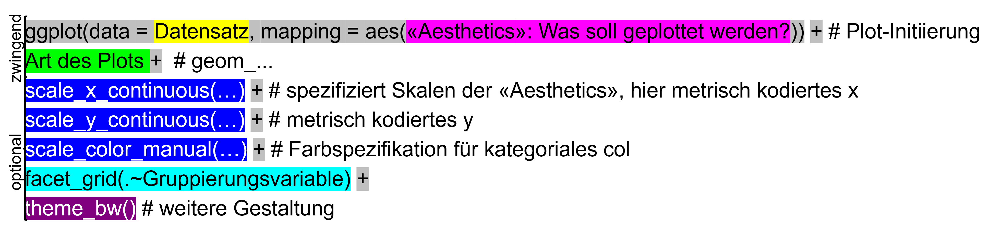

# Woche 12 {.unnumbered}

*Grafiken mit ggplot*

## Lernziele

In dieser Woche beschäftigen wir uns mit ggplot. Es ist ein
leistungsfähiges Visualisierungspaket in R, das heute standardmässig zur
Erstellung von Grafiken mit R verwendet wird und Teil von Tidyverse ist.
Tidyverse ist eine Paket-Sammlung, die auf Datascience ausgerichtet ist.
Entweder können Sie nur ggplot2 oder die gesamte
tidyverse-Paket-Sammlung installieren. ggplot hat eine eigene
Philosophie und es ist deshalb nützlich, erstmal den Aufbau/die Logik zu
verstehen.

Die Lernziele:

-   Sie erläutern, wie Code zur Erstellung von Plots mit ggplot
aufgebaut ist.
-   Sie erstellen Plots mit ggplot2 und erweitern diese Grafiken auf
unterschiedliche Art und Weise.
-   Sie nennen die Vorteile von ggplot2 gegenüber Base R betreffend

## Aufgaben

```{r echo = FALSE}
source(file = "C:/Users/BisangL/Documents/c_fuer_quarto/skripts/datenaufbereitung_ess11.R")
```

::: callout-important
## ggplot2

Grafiken sind systematisch (basierend auf [Grammar of
Graphics](https://link.springer.com/book/10.1007/0-387-28695-0)) in
"Layers" aufgebaut. Die Komponenten sind:

| Element | Inhalt |
|-------------------------|-----------------------------------------------|
| Daten | Datensatz |
| "Aesthetics" | Welche Variablen werden visualisiert (mittels Achsen, Farben, Grössen, Farbintensität...)? |
| Skalen | von... bis..., Skalenniveau... |
| (Geometrische Objekte) | Formen |
| Statistiken | Welche Daten sind wie dargestellt (z.B. Gruppierungen, absolute Häufigkeiten, Regressionslinien...)? |
| Facets | Aufteilung der Daten in mehrere Plots |
| Themes | Wie sind die Plots gestaltet/angeordnet? |

Die Elemente können flexibel miteinander kombiniert werden. Dadurch
lassen sich sowohl einfache Diagramme (z. B. Balken-, Linien- oder
Punktdiagramme) als auch komplexe, mehrschichtige Visualisierungen
erstellen.

Ein Plot muss mit `ggplot(data, aes(...))` initiiert werden. Dann folgt
ein erstes Layer wie zum Beispiel `geom_point()`. Es können weitere
Layers (z.B. `geom_line()`) folgen. Die Layers werden mit einem `+`
miteinander verbunden. Die Plots lassen sich in mehrere Plots aufteilen
(mit z.B. `facet_grid()`) oder mit "Themes" (z.B. `theme_bw()`) zur
grafischen Anpassung vielseitig erweitern.

```{r echo = FALSE, fig.cap = "Aufbau ggplot-Funktion. Graue Bereiche bleiben immer gleich."}

```

Als Input braucht ggplot einen Datensatz im "long"-Format. Das heisst,
Sie müssen unter Umständen diesen Datensatz (mit ggf. Gruppierungen)
vorbereiten. Nützlicher Code ist:

```{r eval = F}
library(tidyverse) # für Pipe-Operatoren (%>%) und ggplot-Funktion
d.g <- d.ch.k %>% 
  group_by(gndr, edlvdch_zf) %>% # Gruppierungsvariablen
  summarise(anz = n()) # zählen
```
:::

1.  Bauen Sie die "Endversion" Ihres Histogramms von Aufgabe 1, Woche 8
mit der `ggplot()`-Funktion nach.

<!-- -->

a.  Kommentieren Sie, wie die Argumente von Base R in ggplot heissen und
wie Sie diese spezifizieren müssen.
b.  Machen Sie daraus für männliche und weibliche Befragte je ein Plot
(Hinweis: `facet_grid()`).

<!-- -->

2.  Bauen Sie die *sinnvollen* "Endversionen" Ihrer bivariaten Grafiken
von Aufgaben 5 und 6, Woche 8 mit der `ggplot()`-Funktion nach.
Nehmen Sie jeweils noch eine zusätzliche Variable mit auf. Nutzen
Sie dafür die Farbgebung, Farbintensität, Punkteart und -grösse oder
-- wie in Aufgabe 1 -- die Möglichkeit, mehrere Plots nebeneinander
zu erstellen.

*Reflexion (bitte betiteln Sie diesen Abschnitt auch mit "Reflexion" in
Ihrem Markdown-Dokument!)*

Bitte reflektieren Sie und halten stichpunktartig fest:

-   Was ist Ihnen klar geworden?
-   Wo sind Sie noch unsicher? Was hat noch nicht geklappt?

## Lösungen

1.  "Endversion" Histogramms (Aufgabe 1, Woche 8)

```{r}
library(tidyverse)
ggplot(data = d.ch.k, mapping = aes(x = wkhtot)) +
  geom_histogram() +
  xlab("Wochenarbeitsstunden") +
  ylab("Häufigkeit") +
  ggtitle("Verteilung der Wochenarbeitsstunden") +
  scale_x_continuous(limits = c(0, 100), breaks = seq(0, 100, 20)) +
  scale_y_continuous(limits = c(0, 500), breaks = seq(0, 500, 100)) +
  theme_bw()
```

a.  Kommentieren Sie, wie die Argumente von Base R in ggplot heissen und
wie Sie diese spezifizieren müssen.

| Argument Base R | Argument ggplot | Spezifikation |
|-------------------|--------------------|----------------------------------------------------|
| `x =` | x = | darzustellende Variable, in aes() |
| `breaks =` | bins = | Anzahl Balken, nicht in aes() |
| `col =` | fill = | Balkenfarbe (Füllung), variablenunabhängig, sonst in aes()! |
| `main =` | ggtitle() + | Titel des Diagramms |
| `xlim/ylim` | scale_x_continuous(limits = c(..., ...), breaks = \[vector\]) + | Spannweite der x-, resp. y-Achse |
| `xlab/ylab` | xlab("...") + | Beschriftung der x-, resp. y-Achse |

b.  Plot für männliche und weibliche Befragte

...die Grafik lässt sich mit ggplot einfach nach Geschlecht
aufteilen, was mit Base R umständlicher ist (siehe Lösungen Woche
8):

```{r} 
ggplot(data = d.ch.k, mapping = aes(x = wkhtot)) +   
  geom_histogram(bins = 50, fill = "blue") +   
  xlab("Wochenarbeitsstunden") +   
  ylab("Häufigkeit") +   
  ggtitle("Verteilung der Wochenarbeitsstunden") +   
  scale_x_continuous(limits = c(0, 100), breaks = seq(0, 100, 20)) + 
  scale_y_continuous(limits = c(0, 300), breaks = seq(0, 300, 50)) +   
  theme_bw() +   
  facet_grid(.~gndr)
```

<!-- -->

2. *Sinnvollen* "Endversionen" bivariate Grafiken (Aufgaben 5 und 6, Woche 8)

Boxplot mit zusätzlicher Variable fineqpy_zf
```{r}
ggplot(data = d.ch.k, mapping = aes(x = gndr, y = wkhtot)) +   
  geom_boxplot() +   
  xlab("Geschlecht") +   
  ylab("Wochenarbeitsstunden") +   
  scale_y_continuous(limits = c(0, 100), breaks = seq(0, 100, 20)) + 
  theme_bw() + 
  facet_grid(.~fineqpy_zf)
```

Männer, die mehr als 42 Stunden die Woche arbeiten, sprechen sich in der Tendenz eher gegen gleiche Bezahlung aus. Ansonsten unterscheiden sich die Verteilungen der Wochenarbeitsstunden nach Geschlecht nicht stark.

Streudiagramm mit zusätzlicher Variable gndr
```{r}
ggplot(data = d.ch.k, mapping = aes(x = agea, y = eduyrs, col = gndr)) +   
  geom_jitter(width = 0.5, height = 0.5, alpha = 0.5) +  
  geom_smooth(method = "lm") +
  xlab("Alter") +   
  ylab("Bildungsjahre") +   
  scale_x_continuous(limits = c(0, 100), breaks = seq(0, 100, 20)) + 
  scale_y_continuous(limits = c(0, 40), breaks = seq(0, 40, 5)) + 
  scale_color_manual(values = c("blue", "red"), breaks = c("m", "w"), labels = c("männlich", "weiblich")) +
  theme_bw()
```
Visuell ist kein Unterschied erkennbar: Männer und Frauen sind ähnlich verteilt. Allerdings unterscheiden sich die Regressionsgeraden: Die Bildungsjahre nehmen mit zunehmendem Alter stärker ab als bei Männern. Das macht Sinn, weil Frauen früher weniger Bildungsjahre zugestanden wurden als Männern.